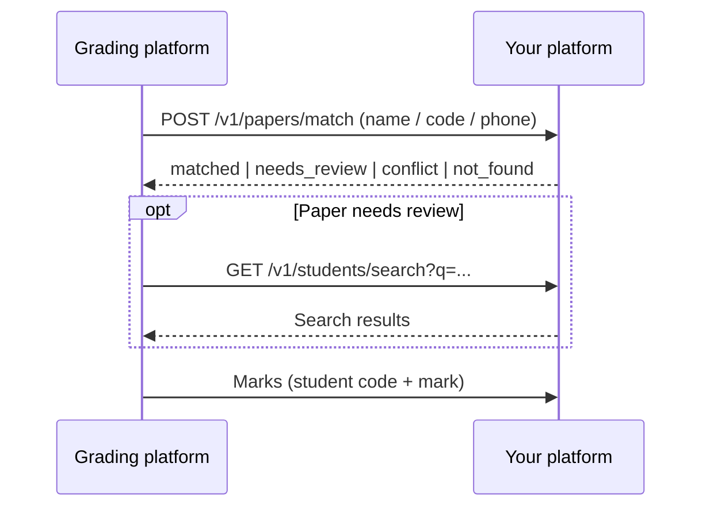

# Student matching for photographed exam papers

An algorithm that decides which student a photographed exam paper belongs to, using what was read from the paper: **name + student code (ID) + phone (if written)**. The repo contains working code, documentation, an API contract and a ready-to-run reference server.

## How it works

All student data lives on your side, so the matching runs on your side:

1. We send you what was read from the paper (name / code / phone — any of them may be `null`).
2. You run this algorithm against your data and return: **matched / needs review / conflict between two students / not found**.
3. If a paper needs review, we search your data manually **by name or code** through a search endpoint on your side.
4. After grading, the marks are sent to you with the confirmed student code.



## Contents

| | |
|---|---|
| [docs/01-matching-algorithm.md](docs/01-matching-algorithm.md) | The algorithm step by step, with an example for every case |
| [docs/02-api-contract.md](docs/02-api-contract.md) | The endpoints you need to provide: request, response, statuses, errors |
| [docs/03-results-push.md](docs/03-results-push.md) | The marks you will receive and the response we expect |

| Code | |
|---|---|
| [src/matching.js](src/matching.js) | The algorithm (pure function, no I/O) |
| [src/normalize.js](src/normalize.js) | Arabic text normalization (أ/ا, ى/ي, ة/ه, Arabic digits…) + `prepareRoster` to prepare your data |
| [src/search.js](src/search.js) | Search by name or code |
| [src/api.js](src/api.js) | Request validation + building the response defined in the contract |
| [examples/server.js](examples/server.js) | Complete reference server (Node, no framework) |

## Running it

Requires Node.js 18 or later.

```bash
npm install
npm test                        # run the tests
API_TOKEN=change-me npm start   # reference server on :8080 with sample data
```

```bash
curl -s localhost:8080/v1/papers/match \
  -H 'Authorization: Bearer change-me' -H 'Content-Type: application/json' \
  -d '{"request_id":"res_1","exam":{"id":"exam_1","name":"Chapter 1 exam","form":"A"},
       "extracted":{"student_code":"1001","student_name":"احمد محمد","student_phone":null}}'

curl -s 'localhost:8080/v1/students/search?q=%D9%85%D9%89' -H 'Authorization: Bearer change-me'
```

The reference server reads students from `examples/roster.sample.json` (fake data). On your side: replace `loadRoster()` with your real students table **and pass it through `prepareRoster()`** (it normalizes codes and phone numbers — [why](docs/01-matching-algorithm.md#input-data)). Everything else can stay as is.

`src/matching.js` is the same algorithm used in grading today (compared on 20,000 random cases — zero differences).

## License

You may view, copy, modify and run this code inside your own systems to integrate with the grading platform. You may not publish it, redistribute it or give it to a third party — see [LICENSE](LICENSE).
