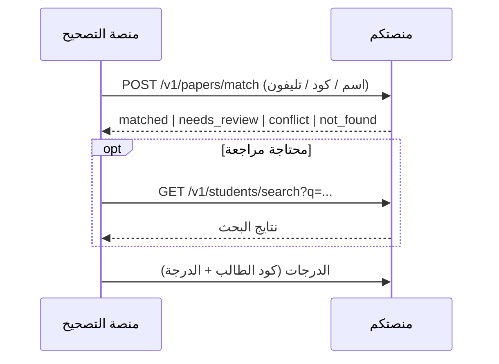

# مطابقة الطالب من ورقة الامتحان

خوارزم بيحدد ورقة امتحان متصوّرة بتاعة أنهي طالب، من البيانات اللي اتقرت من الورقة: **الاسم + الكود (ID) + التليفون (لو مكتوب)** — كود شغال + شرح + عقد API + سيرفر مرجعي جاهز.

## الفكرة

بيانات الطلاب كلها عندكم، فالمطابقة بتحصل عندكم:

1. بنبعتلكم اللي اتقرا من الورقة (اسم / كود / تليفون — أي واحد فيهم ممكن يبقى `null`).
2. بتشغّلوا الخوارزم ده على بياناتكم وترجّعوا: **اتطابق / محتاج مراجعة / تعارض بين طالبين / مش موجود**.
3. لو الورقة محتاجة مراجعة، بندوّر يدويًا **بالاسم أو الكود** على endpoint بحث عندكم.
4. بعد التصحيح، الدرجات بتوصلكم بكود الطالب الأكيد.



## المحتوى

| | |
|---|---|
| [docs/01-matching-algorithm.md](docs/01-matching-algorithm.md) | الخوارزم خطوة بخطوة مع أمثلة لكل حالة |
| [docs/02-api-contract.md](docs/02-api-contract.md) | الـendpoints المطلوبة منكم: الطلب، الرد، الحالات، الأخطاء |
| [docs/03-results-push.md](docs/03-results-push.md) | شكل الدرجات اللي هتوصلكم والرد المطلوب |

| الكود | |
|---|---|
| [src/matching.js](src/matching.js) | الخوارزم (دالة نقية، من غير أي I/O) |
| [src/normalize.js](src/normalize.js) | توحيد الكتابة العربي (أ/ا، ى/ي، ة/ه، أرقام عربي…) |
| [src/search.js](src/search.js) | البحث بالاسم أو الكود |
| [src/api.js](src/api.js) | التحقق من الطلب + بناء الرد حسب العقد |
| [examples/server.js](examples/server.js) | سيرفر مرجعي كامل (Node بدون framework) |

## التشغيل

```bash
npm install
npm test                        # الاختبارات
API_TOKEN=change-me npm start   # السيرفر المرجعي على :8080 ببيانات تجريبية
```

```bash
curl -s localhost:8080/v1/papers/match \
  -H 'Authorization: Bearer change-me' -H 'Content-Type: application/json' \
  -d '{"request_id":"res_1","exam":{"id":"exam_1","name":"امتحان الباب الأول","form":"A"},
       "extracted":{"student_code":"1001","student_name":"احمد محمد","student_phone":null}}'

curl -s 'localhost:8080/v1/students/search?q=%D9%85%D9%89' -H 'Authorization: Bearer change-me'
```

السيرفر المرجعي بيقرا الطلاب من `examples/roster.sample.json` (بيانات وهمية). عندكم: بدّلوا `loadRoster()` بجدول الطلاب الحقيقي، والباقي يفضل زي ما هو.

`src/matching.js` هو نفس الخوارزم المستخدم فعليًا في التصحيح (اتقارن على 20,000 حالة عشوائية — صفر اختلاف).
