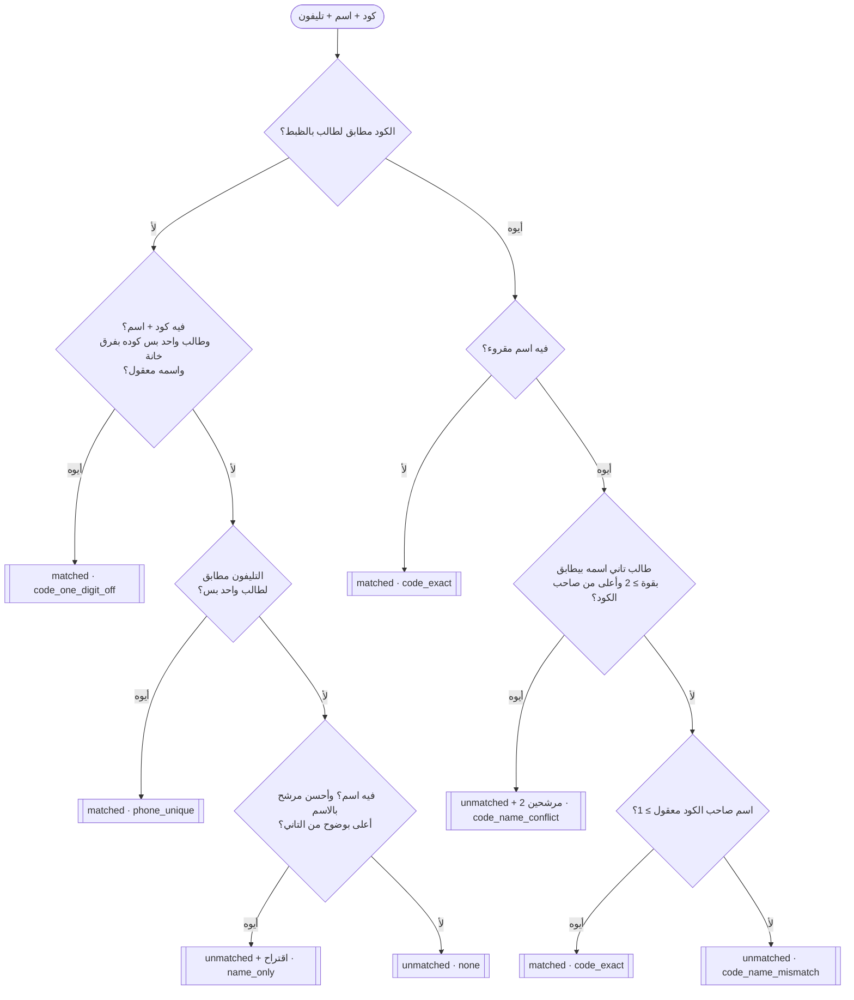

# 01 — خوارزم المطابقة

الكود: [`src/matching.js`](../src/matching.js) — `matchStudent(students, code, name, phone)`.

## المبدأ

> **إشارة قوية + وحيدة = ثقة تلقائية. أي شك = مراجعة.**

درجة متسجّلة لطالب غلط أسوأ من ورقة مستنية مراجعة. عشان كده القبول التلقائي في حالات محددة بس.

## المدخلات والمخرجات

```js
matchStudent(students, extractedCode, extractedName, extractedPhone)
// students: [{ student_code, name, phone? , ...أي حقول تانية }, ...]  ← بعد prepareRoster

// ⟶ {
//   matchedStudent: student | null,
//   status: 'matched' | 'unmatched',
//   method: 'code_exact' | 'code_one_digit_off' | 'phone_unique'
//         | 'code_name_conflict' | 'code_name_mismatch' | 'name_only' | 'none',
//   matchNote: string | null,                              // شرح عربي للمراجع
//   candidates?: [{ student, reason: 'code' | 'name' }]    // في حالة التعارض بس
// }
```

`status: 'unmatched'` مع `matchedStudent` مش فاضي = **اقتراح** محتاج تأكيد (حالة `name_only`).

## البيانات اللي بتدخل الخوارزم

**من الورقة:** أي حقل من التلاتة ممكن يكون `null` (مش مكتوب أو مش مقروء)، والاسم ممكن يكون ناقص (ثنائي بدل ثلاثي) أو فيه اختلافات كتابة.

**من قاعدة بياناتكم — مهم:** الخوارزم بيقارن الكود والتليفون بالتساوي الحرفي، فلازم الطرفين يبقوا بنفس الشكل. مرّروا الطلاب على `prepareRoster(students)` ([`src/normalize.js`](../src/normalize.js)) **مرة واحدة** وقت التحميل (مش في كل طلب):

| من غيرها | اللي بيحصل | `prepareRoster` بتعمل |
|---|---|---|
| الكود متخزّن رقم (`1001`) | الكود عمره ما هيتطابق | بتحوّله نص `"1001"` (والأرقام العربي لإنجليزي) |
| التليفون متخزّن `+201000000001` / `201000000001` | التليفون عمره ما هيتطابق مع `01000000001` | بتوحّده لـ `01XXXXXXXXX` |

- الكود نص: `0123` ≠ `123` — ماتشيلوش الأصفار اللي على الشمال.
- مش لازم يبقى فيه حقل اسمه `id` — الخوارزم بيقارن الطلاب ككائنات.
- الأسماء تكون من غير تشكيل (`أحمَد` مش هتتطابق مع `احمد`).

## أداتين أساسيتين

### 1) درجة تطابق الاسم — `nameMatchScore(extracted, actual)`

1. الاسمين بيتوحّدوا: حروف صغيرة، `أ إ آ ← ا`، `ى ← ي`، `ة ← ه`، أي رمز ← مسافة.
2. بيتقسموا لكلمات، والكلمات اللي أقل من حرفين بتتشال.
3. **الدرجة = عدد كلمات الاسم المقروء اللي ليها كلمة مقابلة في الاسم الحقيقي**، و"مقابلة" يعني واحدة **جوه** التانية (`محمد` ~ `محمدي`، `عبد` ~ `عبدالله`).

| المقروء | الحقيقي | الدرجة |
|---|---|---|
| `احمد محمد` | `أحمد محمد علي` | 2 |
| `ساره على` | `سارة علي حسن` | 2 |
| `منى` | `منى حسن كمال` | 1 |
| `Ahmed` | `Sara Ali` | 0 |

- **معقول** = درجة ≥ 1. **قوي** = درجة ≥ 2 (`STRONG_NAME_MATCH_THRESHOLD`).

### 2) فرق خانة واحدة في الكود — `isOneDigitOff(a, b)`

نفس الطول + خانة واحدة بالظبط مختلفة: `1001`/`1002` ✔️، `1001`/`2002` ✖️، `1001`/`10011` ✖️.

## القواعد بالترتيب

أول قاعدة تنطبق هي اللي بتقرر.



### A — الكود غلط بخانة واحدة (`code_one_digit_off` ← matched)

الكود مش مطابق لحد بالظبط، فيه اسم، **طالب واحد بس** كوده بفرق خانة، واسمه **معقول**.

> مقروء: `2001` + `Ahmed Mohamed Ali` · الطلاب: `1001 Ahmed Mohamed Ali`، `1002 Sara…`، `1003 Mona…` ← **matched** على 1001.

أكتر من طالب بفرق خانة (مقروء `1000` وعندك 1001 و1002 و1003) ← القاعدة مش بتنطبق.

### B — التليفون (`phone_unique` ← matched)

الكود مش مطابق لحد بالظبط (ولا A نفعت)، والتليفون **مطابق حرفيًا** لطالب **واحد بس**.

- تليفون مسجّل لأكتر من طالب (إخوات) ← مش بيتستخدم.
- لو الكود مطابق بالظبط، التليفون مش بيتبص عليه — الكود دايمًا أقوى.

### C — الكود مطابق بالظبط

- **C0** — مفيش اسم ← **matched** (`code_exact`).
- **C1 — تعارض بين طالبين** (`code_name_conflict` ← unmatched): طالب **تاني** اسمه بيطابق **بقوة** (≥ 2) **وأعلى** من صاحب الكود. بيرجع المرشحين الاتنين: `{صاحب الكود, reason: 'code'}` و`{صاحب الاسم, reason: 'name'}`.
  > `1001` + `Sara Ali Hassan` ← 1001 بتاع Ahmed (درجة 1 بسبب "Ali")، و Sara درجتها 3 ← **تعارض**.
- **C2** — مفيش تعارض، واسم صاحب الكود معقول (≥ 1) ← **matched** (`code_exact`).
  > `1001` + `Ahmed Ali` ← "Ali" عند Sara كمان بس كلمة واحدة (أقل من القوي) ← **matched** على Ahmed.
- **C3** — الاسم مالوش علاقة بصاحب الكود (درجة 0) ← **unmatched** (`code_name_mismatch`).

### D — الاسم بس (`name_only` ← unmatched + اقتراح)

مفيش كود مطابق (ولا A ولا B)، وفيه اسم: ترتيب كل الطلاب بدرجة الاسم. لو **الأول أعلى من التاني بوضوح** ← **اقتراح** محتاج تأكيد. **عمره ما بيتأكد تلقائي** — الاسم لوحده مش هوية. لو متعادلين ← مفيش اقتراح.

### E — مفيش حاجة (`none` ← unmatched)

## ملخّص

| `method` | `status` | تلقائي؟ | في الـAPI |
|---|---|---|---|
| `code_exact` | matched | ✔️ | `matched` |
| `code_one_digit_off` | matched | ✔️ | `matched` + `review_recommended: true` |
| `phone_unique` | matched | ✔️ | `matched` + `review_recommended: true` |
| `name_only` | unmatched | ✖️ اقتراح | `needs_review` + `suggested_student` |
| `code_name_mismatch` | unmatched | ✖️ | `needs_review` + صاحب الكود في `candidates` |
| `code_name_conflict` | unmatched | ✖️ طالبين | `conflict` + `candidates` (2) |
| `none` | unmatched | ✖️ | `not_found` |

## اقتراحات المراجعة — `suggestPossibleMatches`

لأي ورقة مش `matched`، لحد 5 اقتراحات:
1. لو فيه `candidates` (تعارض) ← هما بالترتيب ومعاهم السبب.
2. غير كده: صاحب الكود المقروء (لو موجود) + أي طالب اسمه (بعد التوحيد العربي الكامل — [`normalizeAr`](../src/normalize.js)) **فيه** الاسم المقروء أو **جوه** الاسم المقروء.

بحث "احتواء" بسيط، فاسم قصير جدًا ممكن يطلع نتايج زيادة (`مي` جوه `سمير`) — اقتراحات بس.

## ملاحظات للتطبيق

- **نطاق الطلاب**: قائمة `students` أصغر = مطابقة أدق (قواعد "واحد بس" و"أعلى بوضوح" بتشتغل أحسن). على الأقل **طلاب المدرّس ده بس** لو المنصة فيها أكتر من مدرّس. لو تقدروا تحددوا طلاب الامتحان ده بالظبط استخدموها — **لو مش متأكدين، الأوسع أأمن** من إن الطالب الصح يكون برّه القائمة.
- **حمّلوا الطلاب مرة واحدة** (وجهّزوهم بـ`prepareRoster`) واستخدموا نفس القائمة لكل الطلبات لحد ما بياناتكم تتغيّر — فهرس البحث بيتبني مرة واحدة لكل قائمة.
- **الأداء** (على 13,000 طالب): المطابقة ≈ **11 ms للورقة**، البحث ≈ **25 ms** (وبناء فهرس البحث أول مرة ≈ 56 ms).
