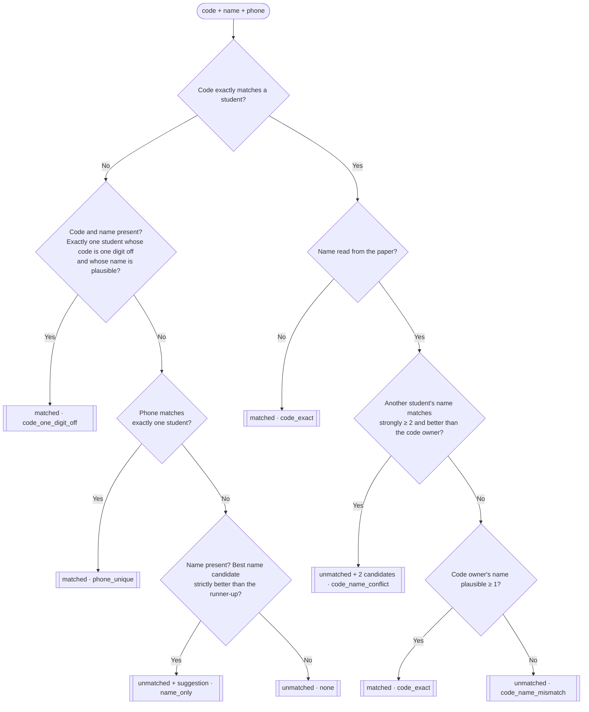

# 01 — The matching algorithm

Code: [`src/matching.js`](../src/matching.js) — `matchStudent(students, code, name, phone)`.

## Principle

> **A strong signal that points to exactly one student = automatic match. Any doubt = review.**

A mark recorded against the wrong student is far worse than a paper waiting for review, so automatic matching only happens in a few well-defined cases.

## Input and output

```js
matchStudent(students, extractedCode, extractedName, extractedPhone)
// students: [{ student_code, name, phone?, ...any other fields }, ...]  ← after prepareRoster

// ⟶ {
//   matchedStudent: student | null,
//   status: 'matched' | 'unmatched',
//   method: 'code_exact' | 'code_one_digit_off' | 'phone_unique'
//         | 'code_name_conflict' | 'code_name_mismatch' | 'name_only' | 'none',
//   matchNote: string | null,                              // Arabic explanation for the reviewer
//   candidates?: [{ student, reason: 'code' | 'name' }]    // only for a conflict
// }
```

`status: 'unmatched'` with a non-null `matchedStudent` is a **suggestion** that must be confirmed (the `name_only` case), not a decision.

## Input data

**From the paper:** any of the three fields may be `null` (not written, or not readable). The name may be incomplete (two names instead of three) or spelled differently.

**From your database — important:** the algorithm compares codes and phone numbers for exact equality, so both sides must be in the same format. Pass your students through `prepareRoster(students)` ([`src/normalize.js`](../src/normalize.js)) **once**, when you load them (not on every request):

| Without it | What happens | What `prepareRoster` does |
|---|---|---|
| Code stored as a number (`1001`) | The code never matches | Converts it to the string `"1001"` (and Arabic digits to Latin) |
| Phone stored as `+201000000001` / `201000000001` | The phone never matches `01000000001` | Normalizes it to `01XXXXXXXXX` |

- Codes are strings: `0123` ≠ `123` — do not drop leading zeros.
- You don't need a field called `id` — the algorithm compares student objects directly.
- Store names without diacritics (tashkeel): `أحمَد` will not match `احمد`.

## Two building blocks

### 1) Name match score — `nameMatchScore(extracted, actual)`

1. Both names are normalized: lower case, `أ إ آ → ا`, `ى → ي`, `ة → ه`, any symbol → space.
2. They are split into words, and words shorter than 2 letters are dropped.
3. **Score = how many words of the extracted name have a matching word in the real name.** Two words match when one **contains** the other (`محمد` ~ `محمدي`, `عبد` ~ `عبدالله`).

| Extracted | Real name | Score |
|---|---|---|
| `احمد محمد` | `أحمد محمد علي` | 2 |
| `ساره على` | `سارة علي حسن` | 2 |
| `منى` | `منى حسن كمال` | 1 |
| `Ahmed` | `Sara Ali` | 0 |

- **Plausible** = score ≥ 1. **Strong** = score ≥ 2 (`STRONG_NAME_MATCH_THRESHOLD`).

### 2) One digit off — `isOneDigitOff(a, b)`

Same length and exactly one different character: `1001`/`1002` ✔️, `1001`/`2002` ✖️, `1001`/`10011` ✖️.

## The rules, in order

The first rule that applies decides.



### A — Code off by one digit (`code_one_digit_off` → matched)

The code matches nobody exactly, a name was read, **exactly one student** has a code that is one digit off, and that student's name is **plausible**.

> Read: `2001` + `Ahmed Mohamed Ali` · Students: `1001 Ahmed Mohamed Ali`, `1002 Sara…`, `1003 Mona…` → **matched** to 1001.

If more than one student is one digit off (read `1000`, and you have 1001, 1002 and 1003), the rule does not apply.

### B — Phone (`phone_unique` → matched)

The code matches nobody exactly (and rule A did not apply), and the phone **exactly equals** the phone of **exactly one** student.

- A phone shared by several students (siblings) is not used.
- If the code matches exactly, the phone is not looked at — the code always wins.

### C — Code matches exactly

- **C0** — No name read → **matched** (`code_exact`).
- **C1 — Conflict between two students** (`code_name_conflict` → unmatched): **another** student's name matches **strongly** (≥ 2) **and better** than the code owner's. Both candidates are returned: `{code owner, reason: 'code'}` and `{name owner, reason: 'name'}`.
  > `1001` + `Sara Ali Hassan` → 1001 belongs to Ahmed (score 1, because of "Ali"), Sara scores 3 → **conflict**.
- **C2** — No conflict, and the code owner's name is plausible (≥ 1) → **matched** (`code_exact`).
  > `1001` + `Ahmed Ali` → "Ali" also appears in Sara's name, but that is a single word (below strong) → **matched** to Ahmed.
- **C3** — The name has nothing in common with the code owner's (score 0) → **unmatched** (`code_name_mismatch`).

### D — Name only (`name_only` → unmatched + suggestion)

No code match (and neither A nor B applied), but a name was read: all students are ranked by name score. If **the top one scores strictly higher than the second**, it is returned as a **suggestion** that must be confirmed. **It is never matched automatically** — a name alone is not an identity. If the top two are tied, there is no suggestion.

### E — Nothing (`none` → unmatched)

## Summary

| `method` | `status` | Automatic? | In the API |
|---|---|---|---|
| `code_exact` | matched | ✔️ | `matched` |
| `code_one_digit_off` | matched | ✔️ | `matched` + `review_recommended: true` |
| `phone_unique` | matched | ✔️ | `matched` + `review_recommended: true` |
| `name_only` | unmatched | ✖️ suggestion | `needs_review` + `suggested_student` |
| `code_name_mismatch` | unmatched | ✖️ | `needs_review` + the code owner in `candidates` |
| `code_name_conflict` | unmatched | ✖️ two students | `conflict` + 2 `candidates` |
| `none` | unmatched | ✖️ | `not_found` |

## Suggestions for review — `suggestPossibleMatches`

For any paper that is not `matched`, up to 5 suggestions:
1. If there are `candidates` (a conflict) → those, in order, with their reason.
2. Otherwise: the owner of the extracted code (if any) + every student whose name (after full Arabic normalization — [`normalizeAr`](../src/normalize.js)) **contains** the extracted name or **is contained in** it.

This is a simple "contains" check, so a very short name can return extra results (`مي` is inside `سمير`) — they are suggestions only.

## Implementation notes

- **Student scope**: a smaller `students` list = more accurate matching (the "exactly one" and "strictly better" rules work better). At minimum, **only this teacher's students** if your platform has more than one teacher. If you can narrow it to the students of this specific exam, do — **if unsure, wider is safer** than leaving the right student out of the list.
- **Load students once** (prepared with `prepareRoster`) and reuse the same list for every request until your data changes — the search index is built once per list.
- **Performance** (13,000 students): matching ≈ **11 ms per paper**, search ≈ **25 ms** (building the search index the first time ≈ 56 ms).
